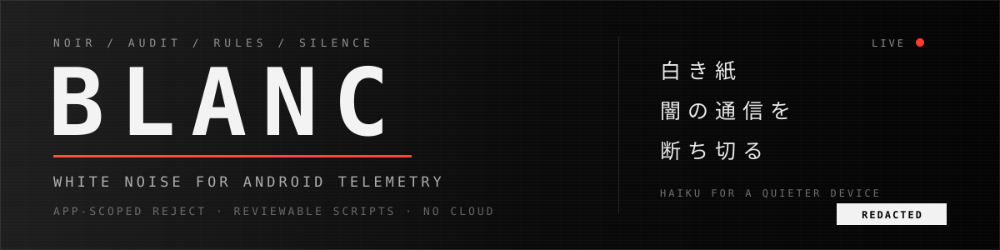

<p align="center">
  
</p>

<h1 align="center">BLANC</h1>

<p align="center"><em>noir2rules: a modern anti-telescreen tool to block telemetry and data exfiltration URLs.</em></p>

<p align="center">
  <a href="LICENSE"></a>
  
  
</p>

BLANC is a small companion to [NOIR](https://github.com/Verlintas/NOIR). It does one job: turn NOIR's domain export into **per-app** Mihomo and sing-box reject rules. It does not scan, run as a daemon, or touch the device.

- **Use BLANC if** you need to block a tracker for one app while keeping it for another.
- **Use NOIR directly if** you only want a flat DNS blocklist; `domains-trackers.txt` already is one.
- **Do not use BLANC** to change device settings; that is NOIR's plan/rollback territory.

One concrete difference: the same `metrics.quietreader.jp` can be rejected for a
shopping app and left alone for a reader. A flat list cannot express that.

> [!WARNING]
> A blocked URL is not privacy. NOIR only sees what is visible in APKs; it
> cannot see vendor-preinstalled services, lower-level frameworks, baseband or
> system processes that report data. Rules can break apps. If you need real
> assurance, move to a trusted device and a trusted operating system as soon as
> you can.

## Build

```sh
go build -trimpath -o blanc ./cmd/blanc
```

On Windows, use `-o blanc.exe`. Go 1.24+. No CGO, no runtime. The only direct
dependency is `gopkg.in/yaml.v3`.

## Quick start

```sh
noir scan --out noir-out
./blanc init
./blanc compile --report noir-out/report.json
./blanc doctor --config ~/.config/mihomo/config.yaml
```

`compile` reads `report.json` and the three NOIR domain files next to it:
`domains-trackers.txt`, `domains-functional.txt`, `domains-other.txt`. If those
files are missing, it stops and says so. There is no second classifier.

## Five files

| file | use |
|---|---|
| `mihomo.rules.yaml` | paste under `rules:`, before broad rules |
| `singbox.json` | app-scoped source rule-set, version 3 |
| `singbox-route.json` | route fragment that rejects the rule-set |
| `SUMMARY.md` | verdicts and the “make it take effect” checklist |
| `manifest.json` | full evidence, input hashes, warnings |

No DNS lists, no quarantine scripts, no decisions file. NOIR already exports
flat lists and remediation plans; app exceptions live in `blanc.yaml`.

## Import

Mihomo: paste the entries from `mihomo.rules.yaml` under `rules:` **before**
`GEOSITE,cn`, `DOMAIN-SUFFIX,cn`, `MATCH`, or any other rule that can match the
same domains. On Android, enable TUN and process matching
(`find-process-mode: always`).

```yaml
rules:
  - AND,((PROCESS-NAME,com.example.app),(DOMAIN-SUFFIX,tracker.nightwatch.cn)),REJECT
  - MATCH,DIRECT
```

sing-box 1.11+:

```json
{
  "route": {
    "rule_set": [
      {
        "tag": "blanc",
        "type": "local",
        "format": "source",
        "path": "./blanc-out/singbox.json"
      }
    ],
    "rules": [{ "rule_set": "blanc", "action": "reject" }]
  }
}
```

`singbox.json` writes each host twice: `domain` for the exact host and `.host`
in `domain_suffix` for subdomains. Do not collapse them; one field alone misses
either the bare host or its subdomains, and bare-suffix behavior has changed
across sing-box versions.

The route fragment's `path` follows `--out`; rewrite it if the rule-set lives
elsewhere on the device.

## Make sure it takes effect

`blanc doctor` reads your Mihomo config and checks a narrow set of concrete facts:

- `find-process-mode` and TUN are enabled;
- BLANC rules are present in `rules:`;
- no obvious earlier `GEOSITE,cn`, `DOMAIN-SUFFIX,cn`, `MATCH`, `PROCESS-NAME`
  or other broad rule shadows them.

It is heuristic: it cannot expand `RULE-SET`, resolve GEOSITE data, or prove
every logical rule. It exits non-zero on a `fail`. The doctor checks Mihomo only;
for sing-box, keep the reject rule before other route rules.

## What silently does nothing

- app rules without TUN or process matching;
- app rules placed after `GEOSITE,cn` / `DOMAIN-SUFFIX,cn` / `MATCH`;
- app-level `PROCESS-NAME` rules on desktop Mihomo;
- a compile that emits zero rules (it warns, but does not protect).

## Policy

`blanc init` writes a small `blanc.yaml`. It only decides which app capabilities
trigger blocking, plus per-app allow/block exceptions. Domain classification
comes from NOIR; BLANC does not reclassify hosts.

See [docs/policy.md](docs/policy.md) or [examples/blanc.yaml](examples/blanc.yaml).

## Notes

- BLANC never phones home.
- NOIR reports contain package names and domains. Review before sharing.
- Rescan when apps change; rules are static evidence applied to a static report.
- This is a compiler for NOIR, not a replacement for a trusted device.
- Upstream: [Verlintas/NOIR](https://github.com/Verlintas/NOIR), MIT.

## Why Go

The proxies are Go and a single static binary is enough. The rule files are
deterministic; the manifest records a timestamp and input hashes. There is
deliberately no TUI, daemon or server: the rule file and the doctor are the
interface.

<p align="center">
  <a href="https://trendshift.io"></a>
</p>

<p align="center"><sub>MIT · made for people who prefer a quiet phone</sub></p>
